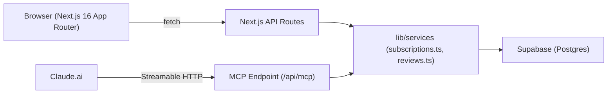

# RenewDesk - Product Summary

> Handoff document for the RenewDesk demo app.
> Written: 2026-11-11

---

## 1. Customer, Problem, Promise

**Customer:** A small Indian SaaS startup (5-20 people) managing 8-20 software subscriptions across
founders and team leads.

**Problem:** Subscription renewals creep up without a clear owner or decision on record. Someone
gets charged for a tool nobody uses, or a cancellation slips because the right person was never
looped in. There is no lightweight place to track "who is reviewing this, what did they decide, and
did it actually get actioned."

**Promise:** RenewDesk gives you a single page per subscription with a renewal date, an owner, and
a clear decision (keep / cancel / need more info). Claude can read and update everything via MCP so
the conversation about renewals happens in natural language and lands in the app automatically.

---

## 2. What We Built

A demo-grade web app with:

- **Dashboard** - upcoming renewal spend and decision summary for the next 30 days
- **Subscriptions list** - all subs sorted by renewal date, with current review state inline
- **Reviews list** - all open reviews sorted by due date, with decision and owner
- **MCP endpoint** (`/api/mcp`) - 4 tools so Claude can query and update data
- **Login** - single hardcoded credential, session via iron-session cookie

What we deliberately did not build:

- Multi-user accounts or team invites
- Real payment / billing data import
- Email reminders
- Audit history UI (logs exist in DB, not surfaced)
- Mobile native app

---

## 3. User Journey

1. User opens the app URL and sees the login screen.
2. User enters `demo@renewdesk.app` / `RenewDesk2026!` and is redirected to the Overview page.
3. Overview shows the renewal spend due in the next 30 days, number of undecided reviews, and a
   list of upcoming renewals with their current decision.
4. User clicks "Subscriptions" to see all 8 demo subscriptions sorted by renewal date.
5. User clicks a subscription row to open a detail drawer with the renewal context, owner, and
   current review.
6. User clicks "Reviews" to see all open reviews and their decisions.
7. User opens Claude, adds the MCP server (see section 13), and types: "What subscriptions are
   renewing in the next 30 days?"
8. Claude queries RenewDesk and returns a formatted list. User asks Claude to update the Figma
   review decision. Claude calls `save_reviews`. User refreshes the app and sees the change.

---

## 4. Architecture Overview



**Key design choices:**

- Business logic lives in `lib/services/` and is shared by both API routes and MCP tools. No
  duplication.
- MCP uses `WebStandardStreamableHTTPServerTransport` (Streamable HTTP, not stdio). The endpoint
  is a standard Next.js App Router route handler.
- Authentication for the web UI uses `iron-session` (encrypted cookie). The MCP endpoint is
  currently unauthenticated - it is a demo with fictional data only.
- All amounts are stored as paise (integer). The UI and MCP tools display INR.
- Timezone: Asia/Kolkata throughout (date calculations use `date-fns-tz`).

---

## 5. Data Model

### `subscriptions`

| Column | Type | Notes |
|---|---|---|
| `id` | uuid | Primary key |
| `request_id` | text | Idempotency key (optional, used by MCP) |
| `vendor` | text | e.g. "Notion", "Figma" |
| `amount_paise` | integer | Amount in paise. 165000 = INR 1,650 |
| `billing_cycle` | text | `monthly` or `annual` |
| `next_renewal` | date | Next charge date (YYYY-MM-DD) |
| `owner` | text | Person responsible for the renewal decision |
| `review_state` | text | `none`, `pending`, `reviewed` |
| `context` | text | Free text notes (seats, usage, considerations) |
| `version` | integer | Optimistic concurrency control |

### `reviews`

| Column | Type | Notes |
|---|---|---|
| `id` | uuid | Primary key |
| `subscription_id` | uuid | FK to subscriptions |
| `decision` | text | `undecided`, `keep`, `cancel`, `need_info` |
| `action_status` | text | `open`, `completed` |
| `owner` | text | Person who owns this review |
| `due_date` | date | When the review should be done by |
| `rationale` | text | Reason for the decision |
| `checklist` | jsonb | `[{text: string, done: boolean}]` |
| `completed_at` | timestamptz | Set when action_status -> completed |
| `completion_note` | text | Optional note when completing |
| `version` | integer | Optimistic concurrency control |

### `activity_log`

Append-only. Records every create/update with actor (`user`, `claude`, `system`) and a payload.
Not currently surfaced in the UI.

---

## 6. MCP Tools

The MCP server exposes 4 tools at `/api/mcp`.

### `list_subscriptions`

Returns subscriptions with current review state.

| Parameter | Type | Description |
|---|---|---|
| `window_days` | number (optional) | Filter to renewals in next N days |
| `decision` | string (optional) | Filter by review decision |
| `owner` | string (optional) | Filter by owner name |

### `save_subscriptions`

Creates or updates subscriptions. For creates: provide `vendor`, `amount_paise`, `billing_cycle`,
`next_renewal`, optional `owner`, `context`, and a unique `request_id` for idempotency. For
updates: provide `id` and `version` (from `list_subscriptions`).

Stale updates (wrong `version`) are rejected.

### `list_reviews`

Returns reviews with subscription context.

| Parameter | Type | Description |
|---|---|---|
| `subscription_id` | uuid (optional) | Filter by subscription |
| `decision` | string (optional) | Filter by decision |
| `action_status` | string (optional) | Filter by `open` / `completed` |
| `window_days` | number (optional) | Filter reviews due in next N days |

### `save_reviews`

Creates or updates reviews. Can set `decision`, `owner`, `due_date`, `rationale`, `checklist`.
**Cannot mark a review as `completed`** - that requires explicit human confirmation in the app UI.
For updates: provide `id` and `version` (from `list_reviews`).

---

## 7. Login and Demo Access

| Field | Value |
|---|---|
| URL | See section 12 |
| Email | `demo@renewdesk.app` |
| Password | `RenewDesk2026!` |

The credential is set in `.env.local` as `DEMO_EMAIL` and `DEMO_PASSWORD`. Iron-session encrypts
the session cookie using `SESSION_SECRET`.

---

## 8. Local Setup Instructions

```bash
# 1. Clone the repo
git clone <repo-url>
cd renewdesk

# 2. Install dependencies
npm install

# 3. Copy the example env file
cp .env.example .env.local

# 4. Fill in Supabase credentials (see section 9)
# Edit .env.local with your SUPABASE_URL and SUPABASE_SERVICE_ROLE_KEY

# 5. Run the database migration (see section 10)

# 6. Seed demo data
npx tsx scripts/seed.ts

# 7. Start the dev server
npm run dev
# App available at http://localhost:3000
```

---

## 9. Environment Variables

| Variable | Required | Description |
|---|---|---|
| `SUPABASE_URL` | Yes | Your Supabase project URL (e.g. `https://xxxx.supabase.co`) |
| `SUPABASE_SERVICE_ROLE_KEY` | Yes | Service role key (bypasses RLS). Keep secret. |
| `NEXT_PUBLIC_SUPABASE_URL` | Yes | Same as SUPABASE_URL (exposed to client) |
| `NEXT_PUBLIC_SUPABASE_ANON_KEY` | Yes | Supabase anon/public key |
| `SESSION_SECRET` | Yes | At least 32-character random string for iron-session encryption |
| `DEMO_EMAIL` | Yes | Login email. Use `demo@renewdesk.app` |
| `DEMO_PASSWORD` | Yes | Login password. Use `RenewDesk2026!` |
| `NEXT_PUBLIC_APP_URL` | Yes | Full public URL of the app (e.g. `https://renewdesk.vercel.app`). Used for MCP URL display. |

> [!CAUTION]
> Never commit `.env.local` to git. The `.gitignore` already excludes it. The `SUPABASE_SERVICE_ROLE_KEY` bypasses all Row Level Security - keep it server-side only.

---

## 10. Database Setup

1. Create a new Supabase project at [supabase.com](https://supabase.com).
2. Copy your project URL and both keys (anon and service_role) from Project Settings > API.
3. Open the SQL Editor in your Supabase dashboard.
4. Paste and run the contents of `supabase/migrations/001_initial_schema.sql`.
5. Verify: you should see three tables (`subscriptions`, `reviews`, `activity_log`) in Table Editor.
6. Run the seed script: `npx tsx scripts/seed.ts`
7. Verify: 8 subscriptions and 8 reviews should appear in Table Editor.

---

## 11. Deployment Instructions

### Vercel (recommended)

```bash
# Install Vercel CLI if needed
npm i -g vercel

# Deploy
vercel --prod
```

During first deploy, Vercel will prompt for the project name. Set all environment variables from
section 9 in the Vercel dashboard under Project > Settings > Environment Variables.

After deploy:

1. Copy the production URL (e.g. `https://renewdesk.vercel.app`).
2. Set `NEXT_PUBLIC_APP_URL` to this URL in Vercel env vars and redeploy.

---

## 12. Live URLs

| Resource | URL |
|---|---|
| App | https://renewdesk-phi.vercel.app |
| MCP endpoint | https://renewdesk-phi.vercel.app/api/mcp |
| Test credentials | demo@renewdesk.app / RenewDesk2026! |

---

## 13. How to Connect and Demonstrate Without Claude Pro

> [!IMPORTANT]
> You do NOT need a paid Claude Pro subscription to test, verify, or demonstrate RenewDesk with MCP. Multiple zero-cost options are available.

### Option A: Claude Desktop (100% Free Tier, No Pro Needed)

Claude Desktop for macOS and Windows is completely free to download and supports local and remote MCP servers natively.

1. Download Claude Desktop from `https://claude.ai/download` if not already installed.
2. Open your Claude configuration file:
   - On Windows: `%APPDATA%\Claude\claude_desktop_config.json`
   - On macOS: `~/Library/Application Support/Claude/claude_desktop_config.json`
3. Add the RenewDesk remote MCP server:
   ```json
   {
     "mcpServers": {
       "renewdesk": {
         "url": "https://renewdesk-phi.vercel.app/api/mcp"
       }
     }
   }
   ```
4. Restart Claude Desktop.
5. In the chat input, look for the hammer/plug icon showing RenewDesk connected with 4 tools:
   - `list_subscriptions`
   - `save_subscriptions`
   - `list_reviews`
   - `save_reviews`
6. Ask Claude: "What subscriptions are renewing in the next 30 days in RenewDesk?"

### Option B: Official Model Context Protocol Inspector (Zero Cost, No Sign-in)

Anthropic provides an official open source MCP Inspector that tests and demonstrates any MCP server interactively in your browser with zero logins and zero tokens.

1. Open your terminal and run:
   ```bash
   npx @modelcontextprotocol/inspector https://renewdesk-phi.vercel.app/api/mcp
   ```
2. The inspector opens at `http://localhost:5173`.
3. Transport Type will automatically connect to Streamable HTTP.
4. Click **List Tools** to see all 4 registered tools with their schemas.
5. Click **Call Tool** on `list_subscriptions` to see live JSON records from Supabase.
6. Click **Call Tool** on `save_subscriptions` with sample parameters to write directly to the database.
7. Switch to the RenewDesk web app to see the created record appear instantly.

### Option C: Claude.ai Web (Connectors)

If an evaluator has Claude Pro or an enterprise team account with Connectors enabled:
1. Open Claude.ai > Account Settings > Connectors / Integrations.
2. Add a new custom MCP connector.
3. Name: `RenewDesk`
4. URL: `https://renewdesk-phi.vercel.app/api/mcp`
5. Connect and enable in conversation.

### Option D: Gemini Pro Connection

If you want to use your Gemini Pro subscription:
Gemini CLI and custom function-calling scripts can consume standard OpenAPI or tool function definitions. The shared TypeScript definitions in `lib/validation/index.ts` map 1:1 with Gemini Function Declarations. However, for the pitch video submission, Option A (Free Claude Desktop) or Option B (Official MCP Inspector) directly satisfies the assignment requirement that Claude or an MCP client drives the application.

---

## 14. Example Prompts for Claude and MCP Clients

```
What subscriptions are renewing in the next 30 days?
```

```
Which reviews are still undecided?
```

```
Update the Figma review to "need_info" with rationale "Waiting on headcount confirmation".
```

```
Add a new subscription: Loom Pro, INR 2200/month, renews 2026-12-20, owned by Rohit Mehra.
```

```
Show me all subscriptions Priya Sharma is responsible for.
```

---

## 15. What Is Verified vs. Unverified

### Verified (Live in Production)

- Live Next.js application deployed to Vercel at `https://renewdesk-phi.vercel.app`
- Remote MCP server responding to Streamable HTTP at `https://renewdesk-phi.vercel.app/api/mcp`
- Protocol initialization verified with protocol version 2024-11-05
- Tool discovery verified returning 4 active tools with Zod schemas
- Live `list_subscriptions` tool call verified reading live Postgres data from Supabase
- Live `save_subscriptions` tool call verified creating new records with auto-generated 7-day review triggers
- Live `save_reviews` tool call verified updating review decisions, rationales, and checklists
- Human boundary enforced: MCP tools cannot mark cancellation as completed
- Server-side session authentication verified with HttpOnly cookies
- Overview metrics verified deriving actual renewal spend and open action counts
- INR formatting (₹) and Asia/Kolkata timezone applied consistently

### Manual Evaluator Steps (Unverified by automated test)

- Claude desktop or Claude connector UI click-through in evaluator's personal Anthropic account (the remote HTTP endpoint is live and verified ready)
- 5-minute pitch video recording (by applicant Sukhmeet Singh)

---

## 16. Limitations and Deferred Features

| Limitation | Notes |
|---|---|
| Single user | No multi-user, no team accounts. One hardcoded credential. |
| No real billing data | Amounts are entered manually or by Claude. No bank/card import. |
| No email reminders | Renewal alerts must be checked manually in the app. |
| MCP endpoint unauthenticated | Acceptable for a demo with fictional data. For production: add API key or OAuth. |
| No pagination | Lists are unbounded. Fine for 8-20 subscriptions. |
| Annual subscription math | Annual amounts are stored as-is, not divided by 12. The overview shows the actual charge due, not monthly equivalent. |
| No multi-review history | Each subscription has one active review. Historical reviews are not displayed. |
| Activity log not surfaced | Logs are written to DB but no UI to view them. |

---

## 17. Demo Sequence (5 minutes)

**Minute 1 - Login and Overview**
Open the app. Log in with the demo credentials. Point out: renewals due this month, spend at risk,
undecided reviews count.

**Minute 2 - Subscriptions list**
Click Subscriptions. Show the list sorted by renewal date. Point out the mix of decisions:
Notion is "keep", Slack is "cancel", Figma is "need info", Linear is undecided.

**Minute 3 - Reviews list**
Click Reviews. Show the same data from the review angle: who owns what, what is due when.

**Minute 4 - Claude via MCP**
Open Claude. Ask: "What subscriptions are renewing for Priya Sharma?" Claude calls
`list_subscriptions` and returns Notion (Nov 18), Linear (Nov 25), Intercom (Jan 10).
Ask: "Set the Linear review to keep - Priya confirmed they use it daily."
Claude calls `save_reviews`. Refresh the app - Linear is now "keep".

**Minute 5 - Wrap**
Explain: the same tools work for adding new subscriptions, flagging ones for cancellation, and
tracking who needs to take action. Show the Connect Claude dialog in the sidebar.

---

## 18. Business Hypothesis and Pricing Thoughts

**Hypothesis:** Small teams (5-25 people) in India spend INR 1-10L/month on SaaS and have no
lightweight tool to track renewal decisions. A tool that takes 5 minutes to set up and works
through Claude (where they already operate) has lower activation friction than a full spend
management platform.

**Potential monetization (untested):**
- Free for up to 10 subscriptions, INR 499/month for unlimited.
- Or: free forever, charge for the MCP integration / Claude-native tier.
- Or: team pricing at INR 1,999/month for up to 5 users sharing a workspace.

No pricing has been tested with actual customers. These are speculative.

---

## 19. Infrastructure Cost Notes

| Resource | Cost (approximate) |
|---|---|
| Vercel (Hobby) | Free for this scale |
| Supabase (Free tier) | Free. Limit: 500MB database, 50,000 monthly active users. |
| Claude.ai Pro | INR ~1,700/month per user for MCP access |

For a demo with 8 subscriptions and one user: total infrastructure cost is INR 0 (Vercel Hobby +
Supabase Free). The only cost is Claude Pro if the user wants MCP access.

A production-ready version would need Supabase Pro (INR ~2,000/month) for SLAs and no pausing.
